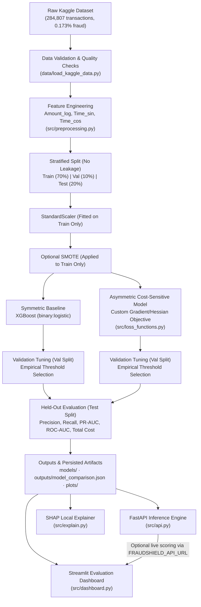
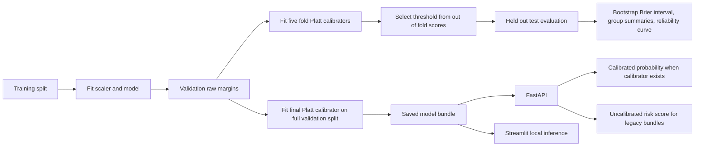

#  FraudShield AI — Cost-Sensitive Machine Learning & Explainable Fraud Architecture

[](https://github.com/Saumya-Mishra-536/FraudShield_AI/actions)
[](https://www.python.org/downloads/)
[](https://xgboost.readthedocs.io/)
[](https://shap.readthedocs.io/)
[](https://fastapi.tiangolo.com/)
[](https://streamlit.io/)

FraudShield AI is an end-to-end, cost-sensitive machine learning system for credit card fraud detection on the Kaggle MLG-ULB dataset (284,807 transactions; 0.173% fraud prevalence).

Most fraud classifiers optimize symmetric metrics such as standard cross-entropy log-loss or ROC-AUC, implicitly treating all errors equally. In real-world financial risk operations, **missing a fraudulent transaction ($FN$) is orders of magnitude more damaging than an unnecessary verification alert ($FP$)**. 

FraudShield AI implements:
1. **Asymmetric Cost-Weighted Gradient Boosting**: A custom second-order XGBoost objective derived directly from weighted logistic loss, incorporating Kahneman & Tversky Prospect Theory loss aversion.
2. **Stratified Random Preprocessing**: Train/validation/test splits, train-only scaling, cyclic time encoding, and optional train-only SMOTE.
3. **Cross-Fitted Calibration and Threshold Selection**: Five-fold out-of-fold Platt scores on validation rows select the threshold; a final Platt calibrator is then fitted on all validation rows; test data is reserved for evaluation.
4. **Local SHAP Attribution**: Transaction-level explainability via `shap.TreeExplainer`, strictly distinguishing instance risk drivers from global feature importance.
5. **Interactive Operations Dashboard & REST API**: Live scenario simulator, operational risk tiers, and complete FastAPI service.

> **Research & Portfolio Disclaimer**: The default false-positive ($C_{FP} = \$5$) and false-negative ($C_{FN} = \$20$) costs are illustrative assumptions, not calibrated banking loss parameters. This repository is an educational and research prototype demonstrating applied cost-sensitive ML and explainability, not an active payment authorization engine.

---

## 🏗️ Architecture & Pipeline Overview



---

### Score calibration and serving



## 📊 Audited Test Results (Held-Out Test Set: 56,962 Transactions)

These metrics come from the refreshed artifact bundle generated on 2026-11-02 with the cross-fitted calibration and threshold-selection strategy. The push-triggered CI workflow independently reproduces model training and evaluation. Costs use the illustrative $5/$20 assumptions.

Reported on the untouched held-out test split after model, calibration, and threshold selection using validation data ($C_{FP} = \$5.00, C_{FN} = \$20.00$):

| Metric | Symmetric XGBoost (Baseline) | Asymmetric XGBoost (Cost-Sensitive) | Operational Impact |
| :--- | :---: | :---: | :--- |
| **Validation-selected Threshold ($\tau$)** | `0.5966` | `0.0492` | Asymmetric threshold selected from five-fold out-of-fold Platt scores |
| **Precision** | `72.92%` | **`80.00%`** | Higher precision at the selected cost operating point |
| **Recall (Fraud Caught Rate)** | `71.43%` | **`85.71%`** | Asymmetric catches 84 / 98 frauds |
| **F1 Score** | `0.7216` | **`0.8276`** | Higher held-out F1 |
| **ROC-AUC** | `0.9603` | **`0.9763`** | Stronger ranking on this split |
| **PR-AUC (Avg Precision)** | `0.6880` | **`0.8686`** | Higher precision-recall area |
| **Brier Score** | `0.15559` | **`0.00041`** | Asymmetric score; bootstrap 95% interval: `[0.000256, 0.000577]` |
| **True Positives ($TP$)** | `70` | **`84`** | 14 additional frauds caught |
| **False Positives ($FP$)** | `26` | **`21`** | 5 fewer false alerts |
| **False Negatives ($FN$)** | `28` | **`14`** | 14 fewer missed frauds |
| **Total Asymmetric Cost** | `$690.00` | **`$385.00`** | 44.2% lower cost under illustrative weights |
| **Cost per Transaction** | `$0.01211` | **`$0.00676`** | Lower cost on this test split |

### Key Takeaways
1. **More Fraud Captured at Fewer False Alerts**: At validation-selected thresholds, the asymmetric model caught 84 fraud cases vs 70 and produced 21 false positives vs 26 on this held-out split.
2. **Lower Illustrative Cost**: Under the project's assumed $5 false-positive and $20 false-negative costs, the test split cost was $385 vs $690. These are illustrative units, not measured bank losses.
3. **Calibrated Scores**: The asymmetric raw margins were calibrated with Platt scaling fitted on validation data. Its Brier score and reliability curve describe the held-out test split; they do not guarantee calibration after deployment or drift.

---

## 📐 Mathematical Formulation

### 1. Weighted Asymmetric Logistic Loss
Let $p_i$ denote the raw margin (logit) produced by the boosted trees, and let $\sigma(p_i) = \frac{1}{1 + e^{-p_i}}$ be the model risk score before calibration. The weighted objective does not make this score a posterior probability. Under false-negative cost $C_{FN}$ and false-positive cost $C_{FP}$:

$$\mathcal{L}(y_i, p_i) = - \left[ C_{FN} \cdot y_i \ln \sigma(p_i) + C_{FP} \cdot (1 - y_i) \ln (1 - \sigma(p_i)) \right]$$

### 2. Analytical Gradient & Hessian
XGBoost optimizes leaf weights using second-order Newton-Raphson boosting. We derive exact derivatives:

- **Gradient ($g_i = \frac{\partial \mathcal{L}}{\partial p_i}$)**:
  $$g_i = - C_{FN} \cdot y_i (1 - \sigma(p_i)) + C_{FP} \cdot (1 - y_i) \sigma(p_i)$$
- **Hessian ($h_i = \frac{\partial^2 \mathcal{L}}{\partial p_i^2}$)**:
  $$h_i = \sigma(p_i)(1 - \sigma(p_i)) \left[ C_{FN} \cdot y_i + C_{FP} \cdot (1 - y_i) \right]$$

**Strict Convexity**: Since $\sigma(p_i) \in (0, 1)$ and $C_{FN}, C_{FP} > 0$, the Hessian $h_i > 0$ strictly for all $p_i \in \mathbb{R}$. This ensures global convexity and guarantees numerical stability during tree building.

### 3. Bayes Optimal Decision Threshold
Under asymmetric costs, the decision rule that minimizes expected loss is:
$$\tau^* = \frac{C_{FP}}{C_{FP} + C_{FN}} = \frac{5}{5 + 20} = 0.200$$
The cross-fitted validation search selected $\tau = 0.0492$. This empirical threshold is specific to this model, split, and illustrative cost assumptions; the theoretical threshold is only a reference under calibrated posterior and cost assumptions.

---

## 🧠 Explainability Architecture: Local SHAP vs Global Importance

FraudShield AI strictly separates **local transaction explanations** from **global model importance**:

```text
┌────────────────────────────────────────────────────────────────────────┐
│                        Explainability Taxonomy                         │
├───────────────────────────────────┬────────────────────────────────────┤
│   Local Attribution (SHAP)        │   Global Feature Importance        │
├───────────────────────────────────┼────────────────────────────────────┤
│ • "Why was TX #38213 blocked?"    │ • "What does the model know overall?"│
│ • Raw-margin breakdown:           │ • Gain: Average improvement in split│
│   margin = base_val + Σ φ_i       │   objective across all trees       │
│ • Flags exact red flags vs        │ • Frequency: Number of tree splits │
│   signals of legitimacy           │ • Dataset-level behavioral trends  │
└───────────────────────────────────┴────────────────────────────────────┘
```

- **Local Attributions** (`src/explain.py`): Uses `shap.TreeExplainer` on the booster. Each transaction's XGBoost raw margin is decomposed into additive feature contributions ($\phi_i$). Its sigmoid is an uncalibrated model score; the dashboard decision uses the separately Platt-calibrated score when a calibrator is present.
- **Red Flags vs Mitigating Signals**: Features with $\phi_i > 0$ represent risk drivers (e.g., extreme negative anomaly in $V14$); features with $\phi_i < 0$ represent mitigating evidence (e.g., standard daytime timestamp).

---

## 🚀 Quickstart & Setup

The dashboard uses saved local artifacts for comparison and historical simulation. For live transaction scoring, set `FRAUDSHIELD_API_URL` to route requests through FastAPI; Docker Compose configures this service connection by default.

### 1. Installation
Requires Python 3.12. CI installs the pinned versions in `requirements.txt`, downloads the repository dataset, trains fresh models, regenerates evaluation artifacts, and then runs integration tests.

```bash
git clone https://github.com/Saumya-Mishra-536/FraudShield_AI.git
cd FraudShield_AI

python3 -m venv .venv
source .venv/bin/activate

pip install --upgrade pip
pip install -r requirements.txt
```

> **Note on OpenMP**: On macOS (Apple Silicon), XGBoost requires `libomp`. If needed: `brew install libomp`.

### 2. Run the End-to-End Training Pipeline
Trains symmetric and asymmetric models, selects the asymmetric threshold from out-of-fold Platt calibrated validation scores, evaluates once on the held-out test split, and writes comparison metrics plus calibration uncertainty and subgroup reports:

```bash
python3 -m src.train
```

Optional arguments:
```bash
python3 -m src.train --c-fp 5.0 --c-fn 20.0 --seed 42 --test-size 0.20 --val-size 0.10
python3 -m src.train --use-smote   # Apply SMOTE to training split only
python3 -m src.train --split-strategy temporal  # Chronological 70/10/20 windows
```

The temporal run writes separate outputs and models under `outputs/time_holdout/` and `models/time_holdout/`; it does not replace the primary random-split bundle.

### 3. Run the Full Test Suite
CI retrains from the repository dataset, regenerates every primary evaluation plot and calibration artifact, runs a separate chronological holdout, verifies both reports, and runs real-artifact integration tests followed by the remaining suite under Python 3.12 with pinned dependencies:

```bash
pytest tests/ -v
```

### Probability calibration and score interpretation

The asymmetric model uses a custom weighted logistic objective, so its raw sigmoid score is a ranking/risk score, not automatically a posterior probability. Training selects its operating threshold from five-fold out-of-fold Platt calibrated validation scores, then fits the served Platt calibrator on the full validation split. The held-out test split is not used for either choice. The primary random-split evaluation reports a bootstrap 95% Brier interval, amount/time slices, and a reliability curve. A separate chronological run reports metrics on the final 20% time window after earlier training and validation windows in `outputs/time_holdout/`. Its time-series scope is still limited to this source dataset's roughly 48 hours; it does not establish performance on a newer calendar period or another dataset. The API includes `probability_calibrated` and `score_semantics`; expected exposure is returned only for calibrated output. Set `FRAUDSHIELD_API_URL` and `FRAUDSHIELD_API_KEY` on the dashboard server to connect live scoring to a protected API. Docker Compose provides this internal connection by default.

### 4. Launch the Interactive Dashboard
Opens the Streamlit operations and simulation interface:

```bash
streamlit run src/dashboard.py
```

Features included:
- **Model Comparison & Audit**: Side-by-side held-out metrics, confusion matrices, and PR/ROC curves.
- **Threshold & Cost Simulator**: Sliders for $C_{FP}$, $C_{FN}$, and decision threshold with live cost curve visualization.
- **Live Transaction Scoring**: Preset scenarios (Normal, Suspicious, Borderline) with local SHAP attribution; set `FRAUDSHIELD_API_URL` to route live scoring through FastAPI.
- **Mathematical & Behavioral Theory**: Mathematical derivations and Prospect Theory curves.

### 5. Launch the REST API
Starts the FastAPI research service locally:

```bash
uvicorn src.api:app --host 127.0.0.1 --port 8000 --reload
```

For local development, API-key authentication is disabled when `FRAUDSHIELD_API_KEY` is unset. In production mode, set `FRAUDSHIELD_ENV=production`; the service then fails readiness and rejects protected requests if no key is configured. Before exposing the service, set a strong key and configure the process-local request limit:

```bash
export FRAUDSHIELD_ENV=production
export FRAUDSHIELD_API_KEY="replace-with-a-long-random-secret"
export API_RATE_LIMIT_PER_MINUTE=60
uvicorn src.api:app --host 127.0.0.1 --port 8000
```

Send the key in the `X-API-Key` header. `/health` and `/health/ready` remain public for probes. The limiter is in memory per process; use a gateway or shared store for multi-worker/public deployments. Request logs include method, path, status, and duration only; invalid payload responses do not echo transaction values. See [documentation.md](documentation.md) for copyable requests.

#### API Endpoints
- `GET /health`: Service health and artifact load status.
- `GET /model-info`: Model metadata, cost parameters, and decision threshold.
- `POST /predict`: Unified fraud decision, risk tier, score, and calibration status.
- `POST /risk-score`: Operational risk tier, action recommendation, model score, top risk factors, and local SHAP drivers. Expected exposure is returned only when the saved score is calibrated.
- `POST /explain`: In-depth SHAP local attribution for the transaction.
- `GET /features/global-importance`: Global XGBoost gain rankings.

---

## 🗂️ Project Structure

```text
FraudShield_AI/
├── .github/
│   └── workflows/
│       └── tests.yml            # Automated CI workflow
├── data/
│   ├── creditcard.csv..gz       # Kaggle dataset archive
│   └── load_kaggle_data.py      # Schema and data-quality validation
├── models/                      # Trained model artifacts & fitted scaler
│   ├── asymmetric_model.pkl
│   ├── symmetric_model.pkl
│   └── scaler.pkl
├── outputs/                     # Persisted evaluation artifacts & figures
│   ├── model_comparison.json   # Random-split held-out metrics
│   ├── calibration_evaluation.json # Bootstrap interval and group summaries
│   ├── time_holdout/            # Chronological later-window evaluation report
│   └── plots/
│       ├── calibration_curve.png       # Held-out reliability curve
│       ├── confusion_matrix_comparison.png
│       ├── prospect_theory_curve.png
│       ├── roc_pr_curves.png
│       ├── shap_bar.png
│       ├── shap_summary.png
│       └── threshold_tuning.png
├── src/
│   ├── __init__.py
│   ├── api.py                   # FastAPI REST service
│   ├── dashboard.py             # Streamlit interactive dashboard
│   ├── evaluate.py              # Visualizations and scenario evaluations
│   ├── explain.py               # SHAP TreeExplainer local attribution engine
│   ├── loss_functions.py        # Weighted asymmetric objective, gradients, Hessians
│   ├── model.py                 # Base, Symmetric, and Asymmetric model wrappers
│   ├── preprocessing.py         # Feature engineering, scaling, train-only SMOTE
│   └── train.py                 # Main training and held-out evaluation pipeline
├── tests/
│   ├── conftest.py              # Pytest environment & path configuration
│   ├── test_api.py              # FastAPI endpoint integration tests
│   ├── test_core.py             # Preprocessing & loss function unit tests
│   ├── test_math_validation.py  # Finite-difference gradient & Hessian validation
│   ├── test_regressions.py      # Data loading and edge-case regressions
│   └── test_smoke.py            # Data-free end-to-end smoke & reproducibility tests
├── requirements.txt             # Pinned project dependencies
└── README.md
```

---

## 📋 Model Card

| Section | Details |
| :--- | :--- |
| **Model Name** | FraudShield Asymmetric Cost-Sensitive XGBoost (v1.2) |
| **Model Type** | Gradient Boosted Decision Trees with Custom Loss |
| **Dataset** | Kaggle Credit Card Fraud Detection (Université Libre de Bruxelles) |
| **Dataset Size** | 284,807 European cardholder transactions across 2 days (492 fraud cases) |
| **Input Features (31)** | `V1`–`V28` (PCA components), `Amount_log` ($\ln(1+\text{Amount})$), `Time_sin`, `Time_cos` |
| **Target Variable** | `Class` (0 = Legitimate, 1 = Fraudulent) |
| **Evaluation Metrics** | Precision, Recall, PR-AUC, ROC-AUC, Asymmetric Operational Cost |
| **Cost Weights** | $C_{FP} = 5.0$, $C_{FN} = 20.0$ (Illustrative banking friction vs loss ratio) |
| **Intended Use** | Decision-support prototype and research demonstration of cost-sensitive ML |
| **Out-of-Scope Use** | Autonomous real-time card authorization without secondary review |

---

## ⚠️ Limitations & Ethical Considerations

1. **Short Historical Horizon**: The dataset spans only 48 hours. Real card networks experience cyclical weekly, monthly, and seasonal fraud shifts.
2. **PCA Anonymization and Integration Boundary**: Features `V1`–`V28` are the output of an anonymizing PCA transform applied to the source provider's original transaction fields. Ordinary bank fields cannot be sent directly to this model. A real integration needs an upstream, versioned feature pipeline that reproduces the same PCA basis, input ordering, centering, scaling, and missing-value rules, or a newly trained model built from features available in the bank's environment. The transformation parameters and source fields are not provided by this dataset, so this repository cannot convert ordinary transaction records into its `V1`–`V28` inputs. It also does not model merchant categories, location, device fingerprints, or velocity features.
3. **Cost Parameter Calibration**: Cost assumptions ($C_{FP} = \$5, C_{FN} = \$20$) vary by card product, interchange tier, and legal jurisdiction. Banks must calibrate these using empirical chargeback accounting and customer churn studies.
4. **False Positive Harm**: False declines disproportionately impact legitimate customers traveling or making atypical purchases. Step-up authentication (`CHALLENGE`) is recommended over immediate hard blocks.
5. **Adversarial Drift**: Fraudsters adapt behaviors when detection boundaries become apparent. Periodic retraining, concept drift monitoring, and shadow-mode evaluation are required before production promotion.
6. **Random Split and Temporal Leakage**: The primary model artifact and headline table use stratified random splits, so nearby transactions and repeated cardholder behavior can appear across splits. CI also runs a separate chronological 70/10/20 holdout, fitting on the earliest rows by Time, selecting calibration and threshold on the next window, and evaluating on the latest window. This is a later segment within the same roughly 48-hour historical source, not independent future data; it cannot establish deployment-period performance.
7. **Calibration Is Not Permanent**: A cross-fitted validation strategy reduces reuse of validation labels for Platt calibration and threshold selection, and the final calibrator is refitted on the full validation split. Bootstrap Brier intervals and amount/time group summaries are reported for both the random-split test and the chronological holdout. The chronological evaluation still comes from the same 48-hour Kaggle source; testing a genuinely newer period or independent dataset remains outstanding. The small fraud count makes subgroup estimates noisy.
8. **Exposure Is Only a Proxy**: When calibrated probabilities are available, probability multiplied by transaction Amount is an exposure proxy. It is not expected chargeback loss because realized loss, recoveries, fees, and customer impact are not modeled.
9. **No Demographic Fairness Audit**: PCA-anonymized fields do not provide enough information to test disparate impact across protected or vulnerable groups.

