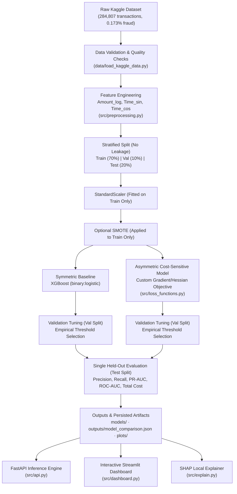

# 🛡️ FraudShield AI — Cost-Sensitive Machine Learning & Explainable Fraud Architecture

[](https://github.com/Saumya-Mishra-536/FraudShield_AI/actions)
[](https://www.python.org/downloads/)
[](https://xgboost.readthedocs.io/)
[](https://shap.readthedocs.io/)
[](https://fastapi.tiangolo.com/)
[](https://streamlit.io/)

FraudShield AI is an end-to-end, cost-sensitive machine learning system for credit card fraud detection on the Kaggle MLG-ULB dataset (284,807 transactions; 0.173% fraud prevalence).

Most fraud classifiers optimize symmetric metrics such as standard cross-entropy log-loss or ROC-AUC, implicitly treating all errors equally. In real-world financial risk operations, **missing a fraudulent transaction ($FN$) is orders of magnitude more damaging than an unnecessary verification alert ($FP$)**. 

FraudShield AI implements:
1. **Asymmetric Cost-Weighted Gradient Boosting**: A custom second-order XGBoost objective derived directly from weighted logistic loss, incorporating Kahneman & Tversky Prospect Theory loss aversion.
2. **Strict Leakage-Free Preprocessing**: Stratified temporal/feature splitting, cyclic time encoding, and train-only SMOTE resampling.
3. **Validation-Only Decision Threshold Tuning**: Decoupled threshold selection on validation data ensuring the final held-out test split is evaluated strictly once.
4. **Local SHAP Attribution**: Transaction-level explainability via `shap.TreeExplainer`, strictly distinguishing instance risk drivers from global feature importance.
5. **Interactive Operations Dashboard & REST API**: Live scenario simulator, operational risk tiers, and complete FastAPI service.

> **Research & Portfolio Disclaimer**: The default false-positive ($C_{FP} = \$5$) and false-negative ($C_{FN} = \$20$) costs are illustrative assumptions, not calibrated banking loss parameters. This repository is an educational and research prototype demonstrating applied cost-sensitive ML and explainability, not an active payment authorization engine.

---

## 🏗️ Architecture & Pipeline Overview



---

## 📊 Audited Test Results (Held-Out Test Set: 56,962 Transactions)

Evaluated strictly once on the untouched held-out test split after validation-based threshold selection ($C_{FP} = \$5.00, C_{FN} = \$20.00$):

| Metric | Symmetric XGBoost (Baseline) | Asymmetric XGBoost (Cost-Sensitive) | Operational Impact |
| :--- | :---: | :---: | :--- |
| **Optimal Threshold ($\tau$)** | `0.210` | `0.160` | Shifts toward theoretical Bayes threshold ($\tau^* = 0.200$) |
| **Precision** | `83.17%` | **`87.50%`** | **+4.33% higher decision precision** |
| **Recall (Fraud Caught Rate)** | `85.71%` | `85.71%` | Identical high capture (84 / 98 frauds caught) |
| **F1 Score** | `0.8442` | **`0.8660`** | **+0.0218 improvement** |
| **ROC-AUC** | `0.9809` | **`0.9824`** | Robust class separation |
| **PR-AUC (Avg Precision)** | `0.8814` | `0.8754` | High precision across all operating thresholds |
| **True Positives ($TP$)** | `84` | `84` | Catches 84 fraudulent transactions |
| **False Positives ($FP$)** | `17` | **`12`** | **29.4% reduction in false alerts (less customer friction)** |
| **False Negatives ($FN$)** | `14` | `14` | Missed fraud bounded |
| **Total Asymmetric Cost** | `$365.00` | **`$340.00`** | **6.85% total operational cost reduction** |
| **Cost per Transaction** | `$0.00641` | **`$0.00597`** | Lower per-transaction overhead |

### Key Takeaways
1. **False Alarm Reduction Without Missing Additional Fraud**: The Asymmetric model eliminated **5 unnecessary account/card blocks** (17 down to 12) while preserving the exact same fraud detection rate (84 caught).
2. **Targeted Tree Splits**: Incorporating asymmetric cost directly into tree splits focuses the tree structure on regions where classification errors have high consequences, rather than merely shifting a post-hoc cutoff.

---

## 📐 Mathematical Formulation

### 1. Weighted Asymmetric Logistic Loss
Let $p_i$ denote the raw margin (logit) produced by the boosted trees, and let $\sigma(p_i) = \frac{1}{1 + e^{-p_i}}$ be the estimated fraud probability. Under false-negative cost $C_{FN}$ and false-positive cost $C_{FP}$:

$$\mathcal{L}(y_i, p_i) = - \left[ C_{FN} \cdot y_i \ln \sigma(p_i) + C_{FP} \cdot (1 - y_i) \ln (1 - \sigma(p_i)) \right]$$

### 2. Analytical Gradient & Hessian
XGBoost optimizes leaf weights using second-order Newton-Raphson boosting. We derive exact derivatives:

- **Gradient ($g_i = \frac{\partial \mathcal{L}}{\partial p_i}$)**:
  $$g_i = - C_{FN} \cdot y_i (1 - \sigma(p_i)) + C_{FP} \cdot (1 - y_i) \sigma(p_i)$$
- **Hessian ($h_i = \frac{\partial^2 \mathcal{L}}{\partial p_i^2}$)**:
  $$h_i = \sigma(p_i)(1 - \sigma(p_i)) \left[ C_{FN} \cdot y_i + C_{FP} \cdot (1 - y_i) \right]$$

**Strict Convexity**: Since $\sigma(p_i) \in (0, 1)$ and $C_{FN}, C_{FP} > 0$, the Hessian $h_i > 0$ strictly for all $p_i \in \mathbb{R}$. This ensures global convexity and guarantees numerical stability during tree building.

### 3. Bayes Optimal Decision Threshold
Under asymmetric costs, the decision rule that minimizes expected loss is:
$$\tau^* = \frac{C_{FP}}{C_{FP} + C_{FN}} = \frac{5}{5 + 20} = 0.200$$
The empirical validation tuning selected $\tau = 0.160$, closely reflecting this theoretical threshold.

---

## 🧠 Explainability Architecture: Local SHAP vs Global Importance

FraudShield AI strictly separates **local transaction explanations** from **global model importance**:

```text
┌────────────────────────────────────────────────────────────────────────┐
│                        Explainability Taxonomy                         │
├───────────────────────────────────┬────────────────────────────────────┤
│   Local Attribution (SHAP)        │   Global Feature Importance        │
├───────────────────────────────────┼────────────────────────────────────┤
│ • "Why was TX #38213 blocked?"    │ • "What does the model know overall?"│
│ • Additive log-odds breakdown:    │ • Gain: Average improvement in split│
│   logit(p) = base_val + Σ φ_i     │   objective across all trees       │
│ • Flags exact red flags vs        │ • Frequency: Number of tree splits │
│   signals of legitimacy           │ • Dataset-level behavioral trends  │
└───────────────────────────────────┴────────────────────────────────────┘
```

- **Local Attributions** (`src/explain.py`): Uses `shap.TreeExplainer` on the booster. Every transaction prediction is decomposed into additive feature contributions ($\phi_i$), showing the base log-odds ($\approx -6.54$, base fraud rate $0.14\%$) plus individual feature contributions.
- **Red Flags vs Mitigating Signals**: Features with $\phi_i > 0$ represent risk drivers (e.g., extreme negative anomaly in $V14$); features with $\phi_i < 0$ represent mitigating evidence (e.g., standard daytime timestamp).

---

## 🚀 Quickstart & Setup

### 1. Installation
Requires Python 3.10 or newer (tested on macOS and Linux).

```bash
git clone https://github.com/Saumya-Mishra-536/FraudShield_AI.git
cd FraudShield_AI

python3 -m venv .venv
source .venv/bin/activate

pip install --upgrade pip
pip install -r requirements.txt
```

> **Note on OpenMP**: On macOS (Apple Silicon), XGBoost requires `libomp`. If needed: `brew install libomp`.

### 2. Run the End-to-End Training Pipeline
Trains symmetric and asymmetric models, optimizes decision thresholds on validation data, evaluates on the held-out test split, and writes comparison metrics:

```bash
python3 -m src.train
```

Optional arguments:
```bash
python3 -m src.train --c-fp 5.0 --c-fn 20.0 --seed 42 --test-size 0.20 --val-size 0.10
python3 -m src.train --use-smote   # Apply SMOTE to training split only
```

### 3. Run the Full Test Suite
Executes 43 comprehensive tests covering core logic, mathematical validation of gradients/Hessians, data-free smoke tests, and API integration:

```bash
pytest tests/ -v
```

### 4. Launch the Interactive Dashboard
Opens the Streamlit operations and simulation interface:

```bash
streamlit run src/dashboard.py
```

Features included:
- **Model Comparison & Audit**: Side-by-side held-out metrics, confusion matrices, and PR/ROC curves.
- **Threshold & Cost Simulator**: Sliders for $C_{FP}$, $C_{FN}$, and decision threshold with live cost curve visualization.
- **Live Transaction Scoring**: Preset scenarios (Normal, Suspicious, Borderline) with full SHAP waterfall and force breakdown.
- **Mathematical & Behavioral Theory**: Mathematical derivations and Prospect Theory curves.

### 5. Launch the REST API
Starts the production-ready FastAPI service:

```bash
uvicorn src.api:app --host 127.0.0.1 --port 8000 --reload
```

Interactive OpenAPI documentation available at: `http://127.0.0.1:8000/docs`

#### API Endpoints
- `GET /health`: Service health and artifact load status.
- `GET /model-info`: Model metadata, cost parameters, and decision threshold.
- `POST /predict`: Binary fraud decision (`ALLOW` / `BLOCK`) and probability.
- `POST /risk-score`: Operational risk tier (`LOW`, `MEDIUM`, `HIGH`, `CRITICAL`), action recommendation, probability-weighted exposure proxy, top risk factors, and local SHAP drivers.
- `POST /explain`: In-depth SHAP local attribution for the transaction.
- `GET /features/global-importance`: Global XGBoost gain rankings.

---

## 🗂️ Project Structure

```text
FraudShield_AI/
├── .github/
│   └── workflows/
│       └── tests.yml            # Automated CI workflow
├── data/
│   ├── creditcard.csv..gz       # Kaggle dataset archive
│   └── load_kaggle_data.py      # Schema and data-quality validation
├── models/                      # Trained model artifacts & fitted scaler
│   ├── asymmetric_model.pkl
│   ├── symmetric_model.pkl
│   └── scaler.pkl
├── outputs/                     # Persisted evaluation artifacts & figures
│   ├── model_comparison.json   # Exact audited test set metrics
│   └── plots/
│       ├── confusion_matrix_comparison.png
│       ├── prospect_theory_curve.png
│       ├── roc_pr_curves.png
│       ├── shap_bar.png
│       ├── shap_summary.png
│       └── threshold_tuning.png
├── src/
│   ├── __init__.py
│   ├── api.py                   # FastAPI REST service
│   ├── dashboard.py             # Streamlit interactive dashboard
│   ├── evaluate.py              # Visualizations and scenario evaluations
│   ├── explain.py               # SHAP TreeExplainer local attribution engine
│   ├── loss_functions.py        # Weighted asymmetric objective, gradients, Hessians
│   ├── model.py                 # Base, Symmetric, and Asymmetric model wrappers
│   ├── preprocessing.py         # Feature engineering, scaling, train-only SMOTE
│   └── train.py                 # Main training and held-out evaluation pipeline
├── tests/
│   ├── conftest.py              # Pytest environment & path configuration
│   ├── test_api.py              # FastAPI endpoint integration tests
│   ├── test_core.py             # Preprocessing & loss function unit tests
│   ├── test_math_validation.py  # Finite-difference gradient & Hessian validation
│   ├── test_regressions.py      # Data loading and edge-case regressions
│   └── test_smoke.py            # Data-free end-to-end smoke & reproducibility tests
├── requirements.txt             # Pinned project dependencies
└── README.md
```

---

## 📋 Model Card

| Section | Details |
| :--- | :--- |
| **Model Name** | FraudShield Asymmetric Cost-Sensitive XGBoost (v1.0) |
| **Model Type** | Gradient Boosted Decision Trees with Custom Loss |
| **Dataset** | Kaggle Credit Card Fraud Detection (Université Libre de Bruxelles) |
| **Dataset Size** | 284,807 European cardholder transactions across 2 days (492 fraud cases) |
| **Input Features (31)** | `V1`–`V28` (PCA components), `Amount_log` ($\ln(1+\text{Amount})$), `Time_sin`, `Time_cos` |
| **Target Variable** | `Class` (0 = Legitimate, 1 = Fraudulent) |
| **Evaluation Metrics** | Precision, Recall, PR-AUC, ROC-AUC, Asymmetric Operational Cost |
| **Cost Weights** | $C_{FP} = 5.0$, $C_{FN} = 20.0$ (Illustrative banking friction vs loss ratio) |
| **Intended Use** | Decision-support prototype and research demonstration of cost-sensitive ML |
| **Out-of-Scope Use** | Autonomous real-time card authorization without secondary review |

---

## ⚠️ Limitations & Ethical Considerations

1. **Short Historical Horizon**: The dataset spans only 48 hours. Real card networks experience cyclical weekly, monthly, and seasonal fraud shifts.
2. **PCA Anonymization**: Features `V1`–`V28` are anonymized components from an internal PCA transformation. Operational deployment in production requires access to raw merchant categories, geolocation, device fingerprints, and transaction velocity features.
3. **Cost Parameter Calibration**: Cost assumptions ($C_{FP} = \$5, C_{FN} = \$20$) vary by card product, interchange tier, and legal jurisdiction. Banks must calibrate these using empirical chargeback accounting and customer churn studies.
4. **False Positive Harm**: False declines disproportionately impact legitimate customers traveling or making atypical purchases. Step-up authentication (`CHALLENGE`) is recommended over immediate hard blocks.
5. **Adversarial Drift**: Fraudsters adapt behaviors when detection boundaries become apparent. Periodic retraining, concept drift monitoring, and shadow-mode evaluation are required before production promotion.
